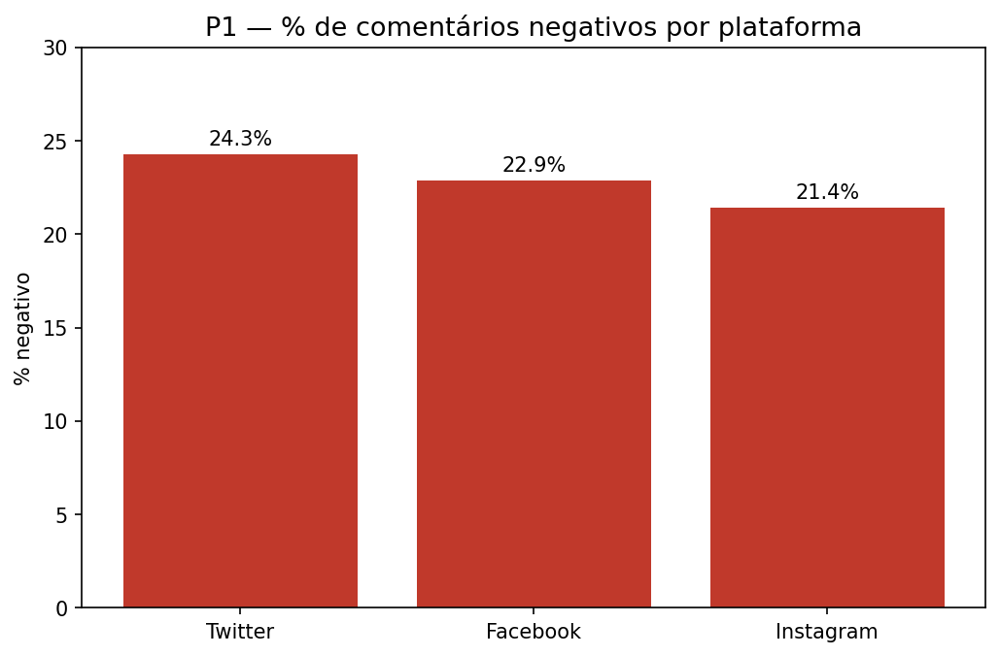
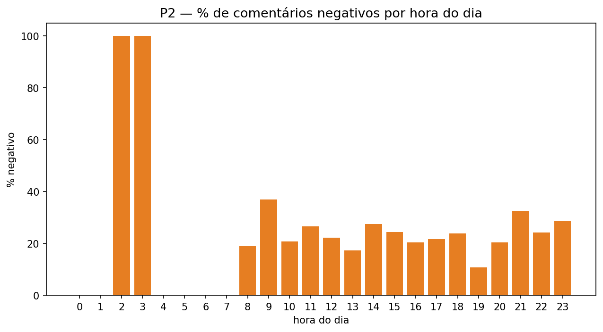
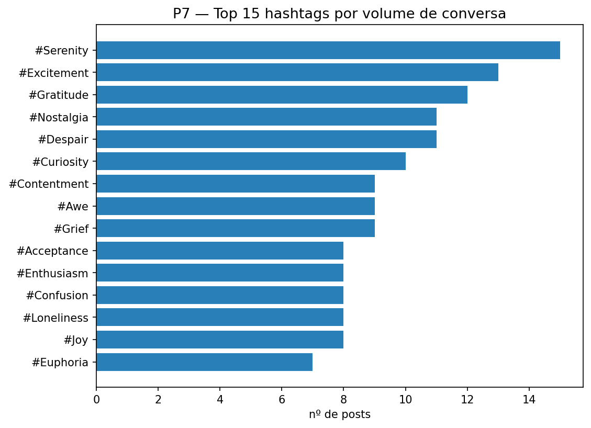

# 📊 Análise de Sentimento em Comentários de Redes Sociais

> **Pipeline completo de Data Science em Databricks** — de um dataset público de posts de Twitter, Instagram e Facebook até a um classificador de sentimento avaliado sem *leakage*, com **7 perguntas de negócio respondidas com os dados**.

[](https://www.python.org)
[](https://spark.apache.org)
[](https://scikit-learn.org)
[](https://databricks.com)
[](#-arquitetura-do-modelo)

---

## 🎯 O que este projeto demonstra

| Competência | Como é demonstrada |
| --- | --- |
| 🗃️ **Engenharia de dados** | Ingestão de um dataset público (Hugging Face) via API, sem credenciais, direto para Spark DataFrame |
| 🧹 **Preparação honesta** | 191 rótulos de emoção consolidados em 3 classes; dedup de textos **antes** do split treino/teste |
| 🤖 **ML disciplinado (anti-leakage)** | Divisão estratificada 80/20 feita **antes** da vetorização TF-IDF; validação cruzada 5-fold só no treino; o teste usado uma única vez |
| 📊 **Análise de negócio** | 7 perguntas de negócio respondidas com os dados, cada uma com justificação e limitações documentadas |

---

## 🔄 Pipeline de dados

```mermaid
flowchart LR
    A["📥 Dataset público Hugging Face<br/>732 posts · 3 plataformas"] --> B["🔍 EDA<br/>191 rótulos · 26 duplicados · 0 nulos"]
    B --> C["🏷️ Consolidação de rótulos<br/>3 classes + dedup → 706 linhas"]
    C --> D["🧼 Limpeza de texto<br/>minúsculas · URLs · hashtags · emojis"]
    D --> E["⚙️ Features determinísticas<br/>nº palavras · hashtags · ! · ? · emojis"]
    E --> F["✂️ Split estratificado 80/20<br/>ANTES da vetorização (sem leakage)"]
    F --> G["🔢 TF-IDF uni+bigramas<br/>aprendido só no treino"]
    G --> H["🤖 Regressão Logística<br/>class_weight = balanced"]
    H --> I["📏 Avaliação no teste<br/>acurácia 0.81 · F1 macro 0.68"]
    I --> J["💼 7 perguntas de negócio"]
```



<sub>💡 **Porque esta ordem?** O TF-IDF aprende o vocabulário a partir dos textos. Se fosse ajustado antes do split, o conjunto de teste influenciaria o treino — *data leakage*. Aqui, o teste só é tocado uma vez, no fim.</sub>

---

## 🧠 Arquitetura do modelo

```
Texto limpo ──▶ TF-IDF (uni+bigramas, min_df=2, sublinear_tf)
            ──▶ Regressão Logística (max_iter=1000, class_weight='balanced')
            ──▶ 3 classes: Positivo · Negativo · Neutro
```

**Resultados no conjunto de teste (142 linhas, nunca visto):**

| Métrica | Valor |
| --- | --- |
| Acurácia | **0.81** |
| F1 macro | **0.68** |
| F1 — Positivo (n=459) | 0.87 |
| F1 — Negativo (n=161) | 0.83 (precisão 0.96) |
| F1 — Neutro (n=86) | 0.34 — a classe difícil, confundida sobretudo com Positivo |

<sub>💡 **F1 macro em vez de só acurácia?** Com 65% de classe Positivo, prever sempre “Positivo” dava 65% de acurácia sem entender nada. O F1 macro (média do F1 das 3 classes) é a métrica justa.</sub>

---

## 📈 Gráficos

### P1 — Qual a plataforma com mais sentimento negativo?
**Twitter (24.3%)**, seguido de Facebook (22.9%) e Instagram (21.4%). A diferença é pequena: não há uma plataforma claramente dominante.



### P2 — Que horários geram mais comentários tóxicos?
Manhã (**9h, 37%**), noite (**21h, 32.5%**) e meio da tarde (**14h, 27.5%**) — útil para dimensionar equipas de moderação.

 

### P7 — Qual o tópico/hashtag com maior volume de conversa?
975 hashtags distintas num total de 706 posts — conversa muito fragmentada. **#Serenity** lidera (15 posts).

 

---

## 💼 As 7 perguntas de negócio

| # | Pergunta | Resposta curta |
| --- | --- | --- |
| P1 | Plataforma com mais sentimento negativo? | **Twitter (24.3%)**, diferença pequena |
| P2 | Horários com mais comentários tóxicos? | **9h (37%), 21h (32.5%), 14h (27.5%)** |
| P3 | Picos de desinformação em datas específicas? | **Não identificável** — sem marcadores de desinformação nem densidade temporal suficiente (nenhuma data tem ≥10 posts) |
| P4 | Palavras mais associadas a sentimento positivo? | **friends (1.57×), beauty e dance (1.46×), joy (1.45×), nature (1.44×)** — por *lift* vs. presença global |
| P5 | % de comentários só com emojis e o seu sentimento? | **0%** só emojis; 11 posts (1.56%) contêm emojis e **todos são positivos** |
| P6 | Comentários mais longos são mais negativos? | **Não** — os negativos são a classe mais curta (80.4 chars); correlação ≈ −0.05 (nula) |
| P7 | Tópico/hashtag com maior volume? | **#Serenity (15 posts)** num leque de 975 hashtags muito fragmentado |

<sub>💡 Cada pergunta tem a sua própria célula no notebook, com pergunta, justificação de negócio e resposta com os dados — incluindo os proxies e limitações usados (ex.: “tóxico” ≈ classe Negativa).</sub>

---

## 📁 Estrutura do repositório

```text
An-lise-Sentimento-Coment-rios-Redes-Sociais/
│
├── README.md                        # este ficheiro
├── requirements.txt                 # dependências Python
├── .gitignore
│
├── notebook/
│   └── analise_sentimento_redes_sociais.ipynb   # pipeline completo (18 células)
│
└── images/
    ├── p1_plataforma_negativo.png    # % negativo por plataforma
    ├── p2_horarios_negativo.png      # % negativo por hora do dia
    └── p7_top_hashtags.png           # top 15 hashtags por volume
```

O notebook está organizado em **STEPs numerados** (1–8, do carregamento à avaliação), seguidos das células **P1–P7** (perguntas de negócio) e uma célula de **Conclusões** — cada célula começa com um cabeçalho: objetivo, input, output e operações.

---

## 📦 Dataset

- **Fonte:** [chuuhtetnaing/myanmar-social-media-sentiment-analysis-dataset](https://huggingface.co/datasets/chuuhtetnaing/myanmar-social-media-sentiment-analysis-dataset) (Hugging Face, público, sem credenciais)
- **Conteúdo:** 732 posts de Twitter, Instagram e Facebook, com texto, rótulo de emoção, plataforma, timestamp, hashtags, país, likes e retweets
- **Após preparação:** 706 linhas únicas (26 duplicados removidos), 3 classes — Positivo 459 · Negativo 161 · Neutro 86

---

## 🚀 Como reproduzir

```bash
# 1. Clonar o repositório
git clone https://github.com/phdprojects/An-lise-Sentimento-Coment-rios-Redes-Sociais.git

# 2. Instalar dependências
pip install -r requirements.txt

# 3. Abrir e executar o notebook (Databricks, Jupyter, Databricks Community Edition...)
#    — executa de cima a baixo, sem dependências externas de credenciais
```

> O notebook foi desenvolvido e executado no **Databricks serverless** (Spark + pandas + scikit-learn). O dataset é descarregado em runtime via API do Hugging Face.

---

## ⚠️ Limitações (documentadas no notebook)

- Dataset **pequeno e parcialmente sintético**: cortes finos (horas, datas, hashtags) têm amostras reduzidas.
- **“Tóxico”** (P2) é aproximado pela classe Negativa — o dataset não tem rótulo de toxicidade.
- **Desinformação** (P3) não é mensurável com estes dados — a resposta honesta é “não identificável”.
- As hashtags espelham os rótulos de emoção do dataset, pelo que a P7 reflete mais a estrutura do dataset do que conversa orgânica.

---

## 🛠️ Stack

`Python` · `PySpark` · `pandas` · `scikit-learn` · `matplotlib` · `Databricks`

---

<sub>Feito com rigor, células a células — e sem leakage. 😉</sub>
